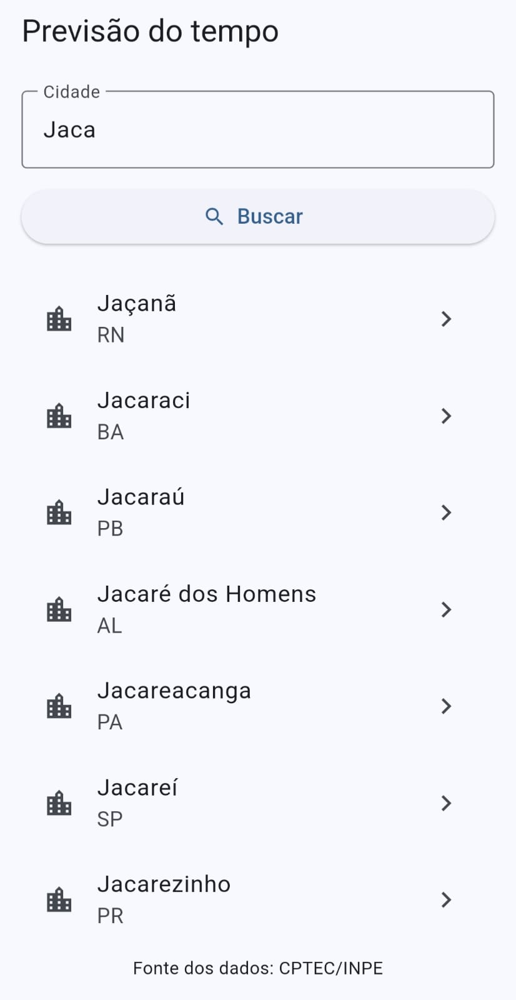
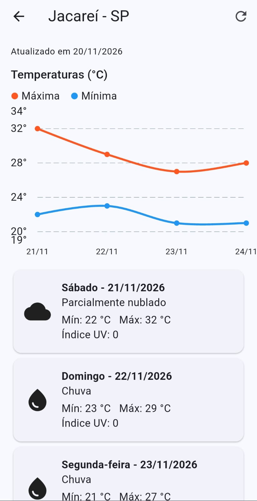
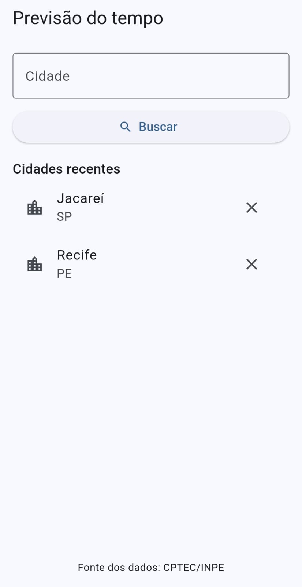
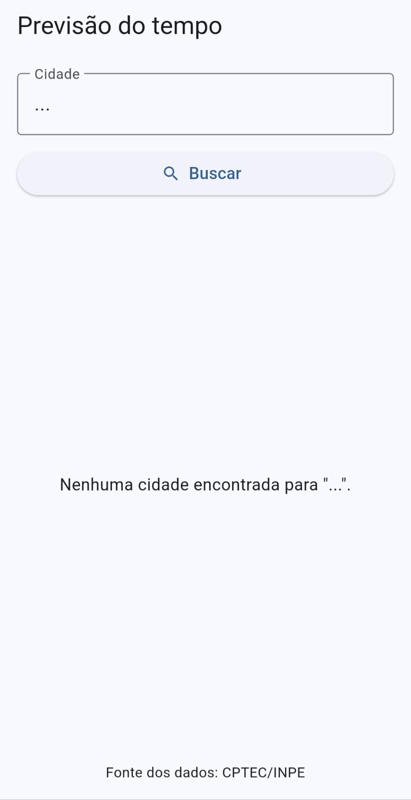

# Previsão do Tempo

Aplicativo Flutter para consultar a previsão do tempo de cidades brasileiras usando os dados do **CPTEC/INPE**.

Atividade 2 de Programação para Dispositivos Móveis II - FATEC.

> **Fonte dos dados:** CPTEC/INPE (http://servicos.cptec.inpe.br/XML/).

## Funcionalidades

- **Pesquisa de cidades** por nome, com validação do campo. Os resultados
  mostram cidade e UF; o código usado na previsão é o identificador retornado
  pelo próprio serviço.
- **Previsão de 4 dias** com: data, temperatura mínima e máxima
  (°C), descrição da condição do tempo, ícone e índice ultravioleta (quando
  disponível). Também exibe a data de atualização informada pelo serviço.
- **Gráfico de temperaturas** (máxima e mínima) dos dias previstos.
- **Conversão das siglas** de condição do tempo em descrições compreensíveis.
- **Atualização manual** da previsão (botão na barra superior) e indicador de
  carregamento durante as consultas.
- **Histórico** de cidades consultadas, com opção de remover itens.
- **Tratamento de erros**: nenhuma cidade encontrada, falha de conexão, tempo
  esgotado, serviço indisponível, resposta inválida, ausência de previsão e
  campos ausentes (exibidos como "--" ou "não disponível", sem encerrar o app).

## Como executar

Pré-requisitos: Flutter instalado e um dispositivo ou emulador **Android**.

```bash
flutter pub get
flutter run
```

Configuração do Android (`android/app/src/main/AndroidManifest.xml`):

- adicionar, dentro de `<manifest>` e antes de `<application>`:

  ```xml
  <uses-permission android:name="android.permission.INTERNET" />
  ```

- adicionar `android:usesCleartextTraffic="true"` ao elemento `<application>`
  (necessário apenas se o serviço não responder por HTTPS; o app tenta HTTPS
  primeiro e usa HTTP como alternativa).

## Bibliotecas utilizadas

| Biblioteca | Uso |
|---|---|
| `http` | Requisições HTTP ao serviço do CPTEC/INPE |
| `xml` | Interpretação das respostas em XML |
| `sqflite` e `path` | Persistência local (SQLite) |
| `fl_chart` | Gráfico de temperaturas |

## Estratégia de persistência local

Os dados são salvos em um banco **SQLite** (`previsao_tempo.db`) com duas tabelas:

- `cidades_recentes`: cidades consultadas (id do serviço, nome, UF e data da
  última consulta). Alimenta a lista de cidades recentes da tela inicial.
- `previsoes_cache`: última previsão obtida de cada cidade, serializada em
  JSON. Ao abrir uma cidade, o app exibe imediatamente esses dados salvos e,
  em seguida, consulta o serviço. Se a atualização falhar, os dados salvos
  continuam visíveis com um aviso.

Falhas no banco local nunca interrompem o uso do aplicativo.

## Estrutura do projeto

```
lib/
├── main.dart
├── models/        cidade.dart, previsao.dart
├── services/      cptec_service.dart, banco_local.dart
├── telas/         tela_busca.dart, tela_previsao.dart
├── utils/         condicoes_tempo.dart, formatar.dart
└── widgets/       grafico_temperaturas.dart
```

## Capturas de tela

### Busca de cidades


### Previsão e gráfico


### Cidades recentes


### Nenhuma cidade encontrada
